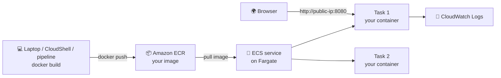

# From Code to Cloud

### Deploy a Containerised App with Amazon ECR & ECS Fargate

**AWS Student Builder Group, Siddhant College of Engineering** · 30 October 2026 (Friday), 11:00 AM · Seminar Hall · Instagram [@aws.scoe](https://instagram.com/aws.scoe)

You'll take a small web app, **package it as a container**, **store it in Amazon ECR**, and **run it on Amazon ECS with AWS Fargate**, with no servers to manage. Then you'll ship a new version, watch ECS heal itself, and scale out.

- 🐳 **Docker** packages the app and everything it needs into one image
- 📦 **Amazon ECR** is your private image registry on AWS
- 🚀 **Amazon ECS + AWS Fargate** runs the container, so you never create or patch a server
- 📜 **Amazon CloudWatch Logs** shows what your container prints
- 🛠️ **Three ways to build and push the image.** Pick the one that works for you ([Pick your build path](#pick-your-build-path)):
  - **A. Your laptop:** Docker Desktop + AWS CLI, in the VS Code terminal
  - **B. AWS CloudShell:** a terminal in the Console with Docker built in. Nothing to install
  - **C. A pipeline:** GitHub Actions builds, pushes and deploys for you

Every AWS resource is created in the **AWS Console**. **No access keys** anywhere: the laptop uses `aws login`, CloudShell uses your Console sign-in, and the pipeline uses OIDC.

> Built by **[CloudAdhar](https://youtube.com/@cloudadhar)**, Building Cloud Futures

---

## Your path in 8 steps
| # | Step | Where | Part |
|---|---|---|---|
| 1 | Get ready and **pick your build path**: laptop, CloudShell or pipeline | Laptop / Console | [1](#part-1-before-the-workshop-3045-min-at-home), [Pick](#pick-your-build-path) |
| 2 | Build the image and test it | VS Code terminal or CloudShell | [2](#part-2-build-and-test-the-container-15-min) |
| 3 | Create an **ECR repository** and **push** the image | Console + terminal (or pipeline) | [3](#part-3-store-the-image-in-amazon-ecr-15-min) |
| 4 | Create an **ECS Fargate cluster** and a **task definition** | Console | [4](#part-4-create-the-cluster-and-task-definition-15-min) |
| 5 | **Run it as a task** and open it **live** in your browser | Console + browser | [5](#part-5-run-it-on-fargate-and-open-it-live-20-min) |
| 6 | Make it a **service**: self-healing and scaling | Console | [5.3](#53-make-it-a-service-always-running), [7](#part-7-self-healing-and-scaling-15-min) |
| 7 | Ship **v2** with a rolling deployment | Terminal + Console (or pipeline) | [8](#part-8-ship-version-2-15-min) |
| 8 | **Clean up** everything | Console | [10](#part-10-clean-up-10-min-dont-skip-this) |

---

## What you'll build



### The words you'll learn
| Word | Meaning in one line |
|---|---|
| **Image** | A packaged app: code + runtime + settings. Built once, runs anywhere |
| **Container** | A running copy of an image |
| **ECR repository** | A private folder on AWS where your images are stored |
| **Cluster** | A logical group for your containers in ECS |
| **Task definition** | The recipe: which image, how much CPU/memory, which port |
| **Task** | One running copy of the recipe (one or more containers) |
| **Service** | Keeps N tasks running all the time, and replaces any that stop |
| **Fargate** | AWS runs the servers for you. You only say "0.25 vCPU, 0.5 GB" |

---

## Cost of this workshop

| Item | Cost |
|---|---|
| CloudShell, ECS cluster, task definitions | Free |
| ECR storage for 2 small images (~60 MB) | Free (500 MB/month free) |
| Fargate: 0.25 vCPU + 0.5 GB, 1–2 tasks for ~2 hours | About US$0.05 |
| Public IPv4 address per running task | About US$0.005 per hour |
| CloudWatch Logs | Practically free |

**Total: less than US$0.10.** Do **Part 10: Clean up** at the end anyway!

---

## Repository structure

```
from-code-to-cloud/
├── README.md         <- full workshop guide (you are here)
├── app.py            <- tiny Python web server (/ and /health)
├── index.html        <- the page you'll see (you'll edit it in Part 8)
├── Dockerfile        <- the recipe to build the image
├── .dockerignore     <- files kept out of the image
├── .github/workflows/build-and-push.yml  <- Path C: build, push and deploy on GitHub
└── docs/
    └── PREREQUISITES.md
```

---

## Pick your build path

Everything from **Part 4** onwards is the same for everyone. Only **where you build and push the image** changes.

**Quick check** in your laptop terminal (VS Code → **Terminal → New Terminal**):
```bash
docker run --rm hello-world
```
- ✅ `Hello from Docker!` → **Path A: your laptop**
- ❌ Any error, or Docker isn't installed → **Path B: CloudShell**. Don't spend more than 3 minutes fixing Docker.

| | **A. Laptop** | **B. CloudShell** | **C. Pipeline** |
|---|---|---|---|
| Needs | VS Code, Docker Desktop, AWS CLI 2.32+ | Only a browser | A GitHub account + one-time IAM setup |
| AWS sign-in | `aws login` | Already signed in | OIDC role (no keys) |
| Get the code | Download ZIP | `git clone` | Fork the repo |
| Test before AWS | Browser: `http://localhost:8080` | `curl http://localhost:8080/health` | — |
| Edit for v2 | VS Code | `nano index.html` | Edit on GitHub ✏️ |
| Your steps | Parts 2–3, **Path A** blocks | Parts 2–3, **Path B** blocks | [Path C](#path-c-build-push-and-deploy-with-github-actions), then Part 4 |

---

## IAM roles and policies used in this workshop

| Who or what | Identity / role | Permissions | Where you set it up |
|---|---|---|---|
| **You** (Console, laptop CLI, CloudShell) | IAM user or IAM Identity Center user. **Not root** | `AdministratorAccess` for the workshop | Part 1.2. `aws login` and CloudShell reuse this sign-in |
| **ECS, to start your task** | **Task execution role** (e.g. `ecsTaskExecutionRole`), trusted by `ecs-tasks.amazonaws.com` | AWS managed `AmazonECSTaskExecutionRolePolicy`: pull the image from ECR, write logs to CloudWatch | Part 4.2 → **Create new role** (or pick an existing task execution role) |
| **Your app, while running** | Task role | None: the app doesn't call any AWS API | Part 4.2 → leave empty |
| **The pipeline** (Path C only) | IAM role trusted by GitHub's OIDC provider, e.g. `github-ecr-push` | `AmazonEC2ContainerRegistryPowerUser` + a small inline policy for ECR Public sign-in and ECS deploy | [Path C → C.2](#c2-let-github-sign-in-to-aws-console-one-time) |
| **Who can reach the app** | Security group `cloudadhar-web-sg` | Inbound **TCP 8080** from Anywhere | Part 5.1 |

> 🔐 The task execution role is used by **ECS**, before your app starts. The task role is used by **your code**, while it runs. Our app needs only the first.

**No "Create new role" option in Part 4.2, or it fails?** Create the task execution role yourself (2 minutes):
1. **IAM** → **Roles** → **Create role**
2. **Trusted entity type:** AWS service · **Service or use case:** **Elastic Container Service** → **Elastic Container Service Task** → **Next**
3. Search and tick **`AmazonECSTaskExecutionRolePolicy`** → **Next**
4. **Role name:** `ecsTaskExecutionRole` → **Create role**
5. Back in Part 4.2, choose it under **Task execution role** (click the refresh icon if it isn't listed yet).

The trust policy IAM writes for you lets only ECS tasks use the role:
```json
{
  "Version": "2012-10-17",
  "Statement": [
    {
      "Effect": "Allow",
      "Principal": {"Service": "ecs-tasks.amazonaws.com"},
      "Action": "sts:AssumeRole"
    }
  ]
}
```

**Where each piece is in this guide**

| What | Steps |
|---|---|
| Your IAM user with `AdministratorAccess` | [docs/PREREQUISITES.md](docs/PREREQUISITES.md), step 1 |
| ECR repository | Part 3.1 |
| ECS cluster | Part 4.1 |
| Task definition + task execution role | Part 4.2 (or the manual steps above) |
| Security group (TCP 8080) | Part 5.1 |
| GitHub OIDC identity provider | Path C → C.2 step 1 |
| Pipeline role: trust policy, `AmazonEC2ContainerRegistryPowerUser`, inline policy | Path C → C.2 steps 2–4 |
| GitHub variables | Path C → C.3 (ECR) and C.5 (ECS) |
| Deleting all of it | Part 10, and the end of Path C |

---

## Part 1: Before the workshop (30–45 min, at home)

Full checklist: **[docs/PREREQUISITES.md](docs/PREREQUISITES.md)**. Do it **at home**: Docker Desktop is a large download. If Docker won't install or start, don't worry: you'll use **Path B (CloudShell)**, which needs nothing installed.

### 1.1 Install these on your laptop (Path A)
| Tool | Why | Get it | Check it (in a terminal) |
|---|---|---|---|
| **VS Code** | Read this guide, edit the code, run commands | [code.visualstudio.com](https://code.visualstudio.com) | Opens ✅ |
| **Docker Desktop** | Build and run the container image | [docker.com/products/docker-desktop](https://www.docker.com/products/docker-desktop/) | `docker --version` |
| **AWS CLI v2** (2.32 or newer) | Sign in to AWS and log Docker in to ECR | [AWS CLI install guide](https://docs.aws.amazon.com/cli/latest/userguide/getting-started-install.html) | `aws --version` |

> 🪟 **Windows:** Docker Desktop needs **WSL 2** (the installer sets it up) and **virtualization turned on** in the BIOS. Restart after installing.
> 🍎 **Mac:** choose the right Docker Desktop download: **Apple chip** (M1–M4) or **Intel chip**.

### 1.2 AWS account
1. **Sign in** to the Console as an IAM user (or IAM Identity Center user) with **AdministratorAccess**. Not the root user.
2. **Region:** top-right of the Console, choose **Asia Pacific (Mumbai) ap-south-1**. Use the **same region for every step**.

### 1.3 Get the code into VS Code
**Option A: Download ZIP (easiest, nothing to install)**
1. Open **https://github.com/cloudadhar/from-code-to-cloud** → green **Code** button → **Download ZIP**. No GitHub account needed.
2. Unzip it (Windows: right-click → **Extract All**; Mac: double-click). You get a folder called `from-code-to-cloud-main`.

**Option B: `git clone` (if you already have Git)**
```bash
git clone https://github.com/cloudadhar/from-code-to-cloud.git
```

Then:
1. In VS Code: **File → Open Folder** → the project folder (`from-code-to-cloud-main` or `from-code-to-cloud`, the one with `README.md` directly inside).
2. Open `README.md` and press **Ctrl+Shift+V** (Mac: **Cmd+Shift+V**) to read this guide nicely.
3. Open the terminal: **Terminal → New Terminal**. Every command in this guide runs there, inside the project folder.

---

## Part 2: Build and test the container (15 min)

### 2.1 Open your terminal and get the code
**Path A (laptop):**
1. Open **Docker Desktop** and wait for **Engine running** (green, bottom left).
2. In VS Code (the project folder from Part 1.3): **Terminal → New Terminal**, then:
```bash
docker --version
```

**Path B (CloudShell):**
1. Console, region **ap-south-1** → click the **CloudShell icon `>_`** in the top bar. Wait about 30 seconds.
2. Get the code (Git and Docker are already installed):
```bash
git clone https://github.com/cloudadhar/from-code-to-cloud.git
cd from-code-to-cloud
docker --version
```
✅ You see a Docker version.

### 2.2 Read the Dockerfile
**Path A:** open `Dockerfile` in VS Code. **Path B:** run `cat Dockerfile`. Every instruction has a numbered comment explaining it:

| # | Instruction | What it does |
|---|---|---|
| 1 | `FROM` | Start from a small official Python image |
| 2 | `LABEL` | Add information about the image |
| 3 | `WORKDIR` | Set the folder inside the container (`/app`) |
| 4 | `RUN` | Run a command while **building** (create a non-root user) |
| 5 | `COPY` | Copy `app.py` and `index.html` into the image |
| 6 | `USER` | Run the app as the non-root user |
| 7 | `ARG` | A value you pass at **build** time (`APP_VERSION`) |
| 8 | `ENV` | Settings the app reads at **run** time (ECS can override them) |
| 9 | `EXPOSE` | Document the port (8080) |
| 10 | `HEALTHCHECK` | How to check the app is alive (`/health`) |
| 11 | `CMD` | The command that starts the app |

That's all a container image is: a base + your files + how to start them.

### 2.3 Build the image (Path A and B)
```bash
docker build --platform linux/amd64 -t from-code-to-cloud:v1 .
docker images from-code-to-cloud
```
✅ You see `from-code-to-cloud   v1` with a size of about 60 MB.

> 💡 `--platform linux/amd64` builds for the **X86_64** CPUs our ECS task uses. Without it, a Mac with an Apple chip (M1–M4) builds an ARM image, and the ECS task fails with `exec format error`. CloudShell is already X86_64, and the flag does no harm there.

### 2.4 Run it and test it
```bash
docker run -d --name web -p 8080:8080 from-code-to-cloud:v1
```
**Path A:** open **http://localhost:8080** in your browser. ✅ The welcome page with fireworks, **Application version: v1** and **Running on: Local Docker container**.

**Path B:** CloudShell can't open a browser tab on `localhost`, so ask the app with `curl`:
```bash
curl http://localhost:8080/health
curl -s http://localhost:8080 | grep -E "version|Running on"
```
✅ `{"status": "healthy"}`, `Application version: v1` and `Running on: Local Docker container`.

Stop and remove it:
```bash
docker stop web
docker rm web
```

> ℹ️ This is your app running in a container **on your machine**. Next, you'll run the exact same image on AWS.

---

## Part 3: Store the image in Amazon ECR (15 min)

### 3.1 Create the repository (Console)
1. Check the region (top right): **Asia Pacific (Mumbai) ap-south-1**.
2. Search **ECR** → **Elastic Container Registry** → left menu **Private registry → Repositories** → **Create repository**.
3. **General settings:**
   - **Repository name:** `from-code-to-cloud` (lowercase; the account and region part in front is filled in for you)
   - **Image tag mutability:** keep **Mutable** (you can push `v1` again if you need to)
4. **Encryption settings:** keep **AES-256** (the default)
5. **Create**.
6. ✅ The repository appears in the list with its **URI**, like `123456789012.dkr.ecr.ap-south-1.amazonaws.com/from-code-to-cloud`. It's empty until you push.

> 💡 **Private** repository, not Public: only your AWS account (and roles you allow, like the ECS task execution role) can pull from it.

### 3.2 Sign the AWS CLI in (Path A only)
**Path B:** skip this. CloudShell is already signed in as you.

```bash
aws configure set region ap-south-1
aws login
```
Your browser opens. Choose your Console session (or sign in) → **Allow**. Back in the terminal:
```bash
aws sts get-caller-identity
```
✅ You see your 12-digit **Account** number. Keep it handy.

> 🔐 No access keys: `aws login` gives the CLI short-term credentials from your Console sign-in, refreshed automatically for up to 12 hours.

### 3.3 Push the image (Path A: VS Code terminal · Path B: CloudShell)
In the Console, open your repository and **copy the URI** next to its name. It looks like `123456789012.dkr.ecr.ap-south-1.amazonaws.com/from-code-to-cloud`.

In the commands below, **replace `123456789012` with your own account ID** (the same on every line).

**1. Log Docker in to your private ECR registry:**
```bash
aws ecr get-login-password | docker login --username AWS --password-stdin 123456789012.dkr.ecr.ap-south-1.amazonaws.com
```
**2. Give the image its ECR name, then push it:**
```bash
docker tag from-code-to-cloud:v1 123456789012.dkr.ecr.ap-south-1.amazonaws.com/from-code-to-cloud:v1
docker push 123456789012.dkr.ecr.ap-south-1.amazonaws.com/from-code-to-cloud:v1
```
✅ `Login Succeeded`, then the push finishes with a `digest: sha256:...` line.

> ℹ️ The Console's **View push commands** button shows the same steps. Use the commands above: our build already added `--platform` (Part 2.3), and we tag `v1` instead of `latest`, so versions stay easy to tell apart.
>
> **Path C:** do Part 3.1, then follow [Path C](#path-c-build-push-and-deploy-with-github-actions) to build and push, and come back to 3.4.

### 3.4 Check it (Console)
Refresh the repository page. ✅ You see an image with tag **v1**. Click it and **copy the Image URI**. It looks like `123456789012.dkr.ecr.ap-south-1.amazonaws.com/from-code-to-cloud:v1`. You'll paste it in Part 4.

---

## Part 4: Create the cluster and task definition (15 min)

### 4.1 Create an ECS cluster
> ⚠️ If ECS opens a page called **Let's set up your app** (Express mode, with an *Infrastructure role*), click **Cancel**. We build each piece ourselves so you learn what it is. Use **Clusters** in the left menu.

1. **Elastic Container Service (ECS)** → **Clusters** (left menu) → **Create cluster**
2. **Cluster name:** the Console fills in a random name (like `infinite-shark-if9ztf`). **Replace it** with `cloudadhar-cluster`
3. **Infrastructure:** keep **Fargate only**. Leave Gateways, Service Connect, Monitoring, Encryption and Tags empty
4. **Create** (takes about 1 minute)

### 4.2 Create the task definition (the recipe)
1. **ECS** → **Task definitions** → **Create new task definition** → **Create new task definition**
2. **Task definition family:** `from-code-to-cloud`
3. **Launch type:** **AWS Fargate** · **Operating system/Architecture:** **Linux/X86_64**
4. **Task size:** **CPU** `.25 vCPU` · **Memory** `.5 GB` (the Console may default to .5 vCPU / 1 GB: change it)
5. **Task role:** leave empty (our app doesn't call AWS)
6. **Task execution role:** **Create new role**, or pick an existing task execution role (e.g. `ecsTaskExecutionRole`). ECS uses it to pull your image and send logs
7. **Container – 1:**
   - **Name:** `web` (the Console may fill in `Main`: change it)
   - **Image URI:** paste the URI from 3.4, ending in `:v1`. *(**Browse ECR images** fills in an `@sha256:...` digest instead. That works too, but the tag is easier to read.)*
   - **Essential container:** Yes
   - **Port mappings:** **Container port** `8080` · **Protocol** TCP · **App protocol** HTTP
   - **Log collection:** keep **Use log collection** ticked (Amazon CloudWatch)
8. **Create**

> 👀 Notice we **don't** set any environment variables. The version comes from the image, and the app reads the real cluster, task and network details from the **ECS task metadata endpoint**, which ECS gives every task automatically.

---

## Part 5: Run it on Fargate and open it live (20 min)

### 5.1 Run it as a task (Console)
A **task** is one running copy of your task definition.

1. **ECS** → **Clusters** → `cloudadhar-cluster` → **Tasks** tab → **Run new task**
2. **Compute configuration:** **Launch type** → **FARGATE** · **Platform version:** LATEST
3. **Deployment configuration:** **Application type:** **Task** · **Family:** `from-code-to-cloud` · **Revision:** latest · **Desired tasks:** `1`
4. **Networking:**
   - **VPC:** default · **Subnets:** keep all selected
   - **Security group:** **Create a new security group**
     - **Name:** `cloudadhar-web-sg` · **Description:** `Workshop web access`
     - **Inbound rule:** **Type** Custom TCP · **Port range** `8080` · **Source** Anywhere
   - **Public IP:** **Turned on** ⚠️ *(without it, the task can't pull the image or be opened from your browser)*
5. **Create** and wait 1–2 minutes

> No default VPC? **VPC** → **Your VPCs** → **Actions** → **Create default VPC**.

### 5.2 Open your app live 🎉
1. **Tasks** tab → refresh until **Last status** is **Running**
2. Click the **task ID** → **Configuration** → copy the **Public IP**
3. In a new browser tab, open `http://<public-ip>:8080` (**http**, not https). Try it on your phone too!

✅ You see the welcome page with fireworks 🎆 and, in the **live** box, real details read from ECS: **Running on: Amazon ECS on AWS Fargate**, your **cluster**, **task ID**, **task definition** (`from-code-to-cloud:1`), **image** (`...:v1`), **Availability Zone**, **private IP**, **CPU/memory** and **region**. Match them with what you see in the Console!

**Your container is now running on AWS, on a server you never had to create.**

Now **stop** this task: select it → **Stop** → **Stop selected**. Refresh your browser: the page is gone. **Nothing brings a plain task back.** That's what a service is for.

### 5.3 Make it a service (always running)
A **service** keeps N tasks running and replaces any that stop.

1. **Clusters** → `cloudadhar-cluster` → **Services** tab → **Create**
2. **Compute configuration:** **Launch type** → **FARGATE**
3. **Deployment configuration:** **Family:** `from-code-to-cloud` · **Revision:** latest · **Service name:** `cloudadhar-web` · **Desired tasks:** `1`
4. **Networking:** **VPC** default · all subnets · **Security group:** **Use an existing security group** → `cloudadhar-web-sg` (from 5.1) · **Public IP:** **Turned on**
5. **Create** and wait 1–2 minutes
6. **Services** → `cloudadhar-web` → **Tasks** tab → click the running task → copy its **Public IP** → open `http://<public-ip>:8080` ✅

---

## Part 6: See the logs (5 min)

1. In the task page → **Logs** tab
2. Refresh your app in the browser a few times, then refresh the logs
3. ✅ You see one JSON line per request: `{"client": "...", "request": "GET / HTTP/1.1", ...}`

Everything your container prints goes to **CloudWatch Logs** automatically. That's how you debug containers in production.

---

## Part 7: Self-healing and scaling (15 min)

### 7.1 Break it on purpose
1. **Tasks** tab → select the running task → **Stop** → **Stop selected**
2. Watch the **Tasks** tab (refresh). Within about a minute, ECS starts a **new task** by itself.
3. Open the new task's **Public IP** on port 8080. ✅ It works again, with a **new task ID and private IP**, maybe in a different Availability Zone.

> 💡 The **service** promised "always 1 task running". When one stopped, ECS replaced it. Nobody had to wake up at 3 AM.
>
> Notice the **public IP changed**. That's why real apps put an **Application Load Balancer** in front: one fixed address, whatever happens to the tasks (see Bonus 1).

### 7.2 Scale out
1. **Services** → `cloudadhar-web` → **Update service**
2. **Desired tasks:** `2` → **Update**
3. ✅ Two tasks run. Open each Public IP: same app, **different task IDs**, often in **different Availability Zones**.

Set **Desired tasks** back to `1` when you're done, to save cost.

---

## Part 8: Ship version 2 (15 min)

### 8.1 Change the app
Find the line under `<!-- Part 8 ... -->` in `index.html` and change the text to your own message, e.g. `Deployed by Priya on ECS Fargate 🚀`.
- **Path A:** in VS Code, then save with **Ctrl+S** (Mac: **Cmd+S**).
- **Path B:** `nano index.html` → edit → save with `Ctrl+O`, `Enter` → exit with `Ctrl+X`.
- **Path C:** on GitHub, open `index.html` in your fork → pencil ✏️ → edit → **Commit changes**. Then run the workflow with tag `v2` (or, with CD turned on, it deploys by itself) and skip to 8.3 step 5.

### 8.2 Build, test and push v2 (Path A and B)
Replace `123456789012` with your account ID again:
```bash
docker build --platform linux/amd64 --build-arg APP_VERSION=v2 -t 123456789012.dkr.ecr.ap-south-1.amazonaws.com/from-code-to-cloud:v2 .
docker run -d --name web2 -p 8080:8080 123456789012.dkr.ecr.ap-south-1.amazonaws.com/from-code-to-cloud:v2
```
**Path A:** open **http://localhost:8080**. **Path B:** `curl -s http://localhost:8080 | grep -E "version|Deployed"`. ✅ **Application version: v2** with your message. Then stop it and push:
```bash
docker stop web2
docker rm web2
aws ecr get-login-password | docker login --username AWS --password-stdin 123456789012.dkr.ecr.ap-south-1.amazonaws.com
docker push 123456789012.dkr.ecr.ap-south-1.amazonaws.com/from-code-to-cloud:v2
```
✅ ECR now shows two tags: **v1** and **v2**.

### 8.3 Deploy v2 (Console)
1. **ECS** → **Task definitions** → `from-code-to-cloud` → select the latest revision → **Create new revision**
2. In **Container – 1**, change the **Image URI** ending from `:v1` to `:v2` → **Create** (this is revision 2)
3. **Clusters** → `cloudadhar-cluster` → **Services** → `cloudadhar-web` → **Update service**
4. **Revision:** choose the new one (2) → **Update**
5. Open the **Deployments** tab: ECS starts a v2 task, checks it is running, then stops the v1 task. This is a **rolling deployment**.
6. Open the new task's Public IP. ✅ **Application version: v2** with your message, **Task definition** `from-code-to-cloud:2` and **Image** ending in `:v2`!

> Something wrong with v2? Update the service back to revision 1. That's a **rollback**, in one click.

---

## Part 9: What just happened? (recap)

```
Code (laptop) ──docker build──▶ Image ──docker push──▶ ECR ──pull──▶ ECS Fargate task
                                                                       ▲
                                     Service keeps N tasks running ────┘
```
- **ECR** stores versions of your image (`v1`, `v2`).
- The **task definition** says *which* image and *how much* CPU/memory.
- The **service** keeps the right number of tasks running, replaces failed ones, and rolls out new versions.
- **Fargate** means you never created, patched or paid for an idle EC2 server.

---

## Part 10: Clean up (10 min). Don't skip this!

Do these **in order**:

| # | Delete | Where |
|---|---|---|
| 1 | Service `cloudadhar-web` | ECS → Clusters → `cloudadhar-cluster` → Services → select → **Delete service** → tick **Force delete** → type `delete` |
| 2 | Cluster `cloudadhar-cluster` | ECS → Clusters → `cloudadhar-cluster` → **Delete cluster** (after the tasks have stopped) |
| 3 | Task definition `from-code-to-cloud` | ECS → Task definitions → select it → select all revisions → **Actions** → **Deregister**, then **Actions** → **Delete** |
| 4 | ECR repository `from-code-to-cloud` | ECR → Repositories → select → **Delete** → type `delete` (deletes the images too) |
| 5 | Security group `cloudadhar-web-sg` | EC2 → Security Groups → select → **Actions** → **Delete security groups** |
| 6 | Log group `/ecs/from-code-to-cloud` | CloudWatch → Log groups → select → **Actions** → **Delete** |
| 7 | *(optional)* IAM role `ecsTaskExecutionRole` | IAM → Roles → search → **Delete** (it's free, so keeping it is fine) |

✅ Check: **ECS → Clusters** is empty and **ECR → Repositories** is empty. No running tasks means no cost.

---

## Bonus challenges

1. **Application Load Balancer:** create the service with **Load balancing** → **Application Load Balancer**, so the app has one fixed URL. *(An ALB costs about US$0.02/hour, so delete it afterwards.)*
2. **Auto scaling:** in the service, add **Service auto scaling** with a target of 50% CPU, min 1, max 3 tasks.
3. **Health check:** in the task definition, add a container health check: `CMD-SHELL, python -c "import urllib.request; urllib.request.urlopen('http://127.0.0.1:8080/health')" || exit 1`.
4. **CI/CD:** turn on automatic deploys with the workflow in **Path C** (C.5): every commit to `main` builds, pushes and deploys.
5. **Try a different image:** create a new task definition with the public image `public.ecr.aws/nginx/nginx:latest` on port 80.

---

## Troubleshooting

| Problem | Fix |
|---|---|
| `docker: command not found` | **Mac:** Docker was opened from the installer disk. Quit it, drag **Docker.app** into **Applications**, eject the Docker disk, open Docker from Applications. **Windows:** restart VS Code (or the laptop) after installing |
| `Cannot connect to the Docker daemon` / `error during connect` | Docker Desktop isn't running. Open it and wait for **Engine running** |
| Docker Desktop won't start | See **Docker Desktop won't start?** below. Still stuck after 3 minutes? Switch to **Path B (CloudShell)** |
| `aws: command not found` or `Invalid choice: 'login'` | Install or update the AWS CLI to **2.32 or newer**, then restart VS Code |
| `Unable to locate credentials` | Run `aws login` again (it lasts up to 12 hours) |
| `aws login`: *Profile 'default' is already configured with Access Key credentials* | Old access keys are saved on your laptop. Sign in under a new profile instead: `aws login --profile workshop --region ap-south-1`, then `export AWS_PROFILE=workshop` (Windows PowerShell: `$env:AWS_PROFILE="workshop"`). Run the `export` again in every new terminal |
| `The security token included in the request is invalid` | Same cause: old access keys. Use the `--profile workshop` fix above |
| `zsh: command not found: #` (Mac) | You pasted a comment line. Paste only the command lines |
| `no basic auth credentials` on `docker push` | Run the `aws ecr get-login-password ... docker login` line again |
| `repository ... does not exist` on push | The repo name, account ID or region doesn't match. It must be `from-code-to-cloud` in **ap-south-1** |
| `429 Too Many Requests` / `toomanyrequests` when building | Too many anonymous downloads of the base image from your network. Sign Docker in to ECR Public, then build again: `aws ecr-public get-login-password --region us-east-1 \| docker login --username AWS --password-stdin public.ecr.aws` |
| Port `8080` already in use on your laptop | Run `docker ps`, then `docker stop` and `docker rm` the old container |
| Task stops with `exec format error` | The image was built for ARM (Apple chip). Rebuild with `--platform linux/amd64` and push again |
| Task stops with `CannotPullContainerError` | **Public IP** was off, or the Image URI is wrong. Check the URI ends in `:v1`, and recreate the service with Public IP **Turned on** |
| Task stops with `ResourceInitializationError` | Same as above: usually no public IP, so the task can't reach ECR |
| Browser keeps loading / times out | Use `http://` (not https) and port `:8080`. Check the security group allows **TCP 8080** from **Anywhere** |
| Page shows `Application version: v1` after deploying v2 | The service still uses the old revision, or you pushed v2 to a different tag. Check the task's image URI ends in `:v2` |
| Task status is **Pending** for a long time | Wait 2 minutes. Still pending? Open the task → **Stopped reason** |
| Can't delete the cluster | The service still has tasks. Delete the service first (step 1) and wait until the tasks stop |
| Can't delete the security group | A task is still using it. Wait until all tasks have stopped |

---

## Docker Desktop won't start?

Try these in order. Give it **3 minutes**, then switch to **Path B** (CloudShell). You can still do the whole workshop.

**Any laptop**
1. Quit Docker Desktop and open it again. The first start can take **2 minutes**: wait for **Engine running**.
2. Restart the laptop.
3. Check free disk space: Docker needs about **10 GB** free.
4. Docker Desktop → **Troubleshoot** (bug icon, top right) → **Restart Docker Desktop**. Still stuck? **Reset to factory defaults** in the same menu.

**Mac**
| You see | Do this |
|---|---|
| `docker: command not found` | Docker was opened from the installer disk. Quit it, drag **Docker.app** into **Applications**, eject the Docker disk, open Docker from Applications, restart VS Code |
| Stuck on **Docker Desktop is starting…** | Quit it → open again → **Troubleshoot** → **Clean / Purge data** |
| "This version of macOS is not supported" | Docker Desktop needs a recent macOS. Use Path B (CloudShell) |

**Windows**
| You see | Do this |
|---|---|
| **WSL 2 installation is incomplete** / WSL needs updating | PowerShell **as administrator**: `wsl --install`, then `wsl --update`. Restart |
| **Virtualization support not detected** | Turn on virtualization in the BIOS (*Intel VT-x* or *AMD-V/SVM*). In **Turn Windows features on or off**, tick **Virtual Machine Platform** and **Windows Subsystem for Linux**. Restart |
| **Unexpected WSL error** | PowerShell: `wsl --shutdown`, then open Docker Desktop again |
| No admin rights (college or office laptop) | You can't install Docker. Use Path B (CloudShell) |

---

## Path C: Build, push and deploy with GitHub Actions

A pipeline: GitHub builds the image and pushes it to **your** ECR repository, and (with C.5) deploys it to your ECS service. You need a free **GitHub account**. It takes about 10 minutes to set up once. No access keys: GitHub signs in to AWS with a short-lived token (OIDC) and an IAM role you create.

The workflow is [.github/workflows/build-and-push.yml](.github/workflows/build-and-push.yml). It runs when you click **Run workflow**, and (once C.5 is set up) on every commit to `main` that changes `app.py`, `index.html` or the `Dockerfile`.

### C.1 Fork the repo (GitHub)
1. Open **https://github.com/cloudadhar/from-code-to-cloud** → **Fork** → **Create fork**.
2. In **your** fork → **Actions** tab → **I understand my workflows, go ahead and enable them**.

### C.2 Let GitHub sign in to AWS (Console, one time)
1. **IAM** → **Identity providers** → **Add provider**
   - **Provider type:** OpenID Connect
   - **Provider URL:** `https://token.actions.githubusercontent.com`
   - **Audience:** `sts.amazonaws.com` → **Add provider**
   - Already in the list? Skip this step.
2. **IAM** → **Roles** → **Create role**
   - **Trusted entity type:** Web identity
   - **Identity provider:** `token.actions.githubusercontent.com` · **Audience:** `sts.amazonaws.com`
   - **GitHub organization:** your GitHub username · **GitHub repository:** `from-code-to-cloud` · **GitHub branch:** `main` → **Next**
   - **Permissions:** tick `AmazonEC2ContainerRegistryPowerUser` (build and push to ECR) → **Next**
   - **Role name:** `github-ecr-push` → **Create role**
3. Open the role → **Permissions** → **Add permissions** → **Create inline policy** → **JSON**, paste this (replace `123456789012` with your account ID) → name it `ecr-public-and-ecs-deploy` → **Create policy**:
```json
{
  "Version": "2012-10-17",
  "Statement": [
    {
      "Sid": "EcrPublicSignInForTheBaseImage",
      "Effect": "Allow",
      "Action": ["ecr-public:GetAuthorizationToken", "sts:GetServiceBearerToken"],
      "Resource": "*"
    },
    {
      "Sid": "EcsDeployForCD",
      "Effect": "Allow",
      "Action": ["ecs:DescribeTaskDefinition", "ecs:RegisterTaskDefinition", "ecs:DescribeServices", "ecs:UpdateService"],
      "Resource": "*"
    },
    {
      "Sid": "LetEcsUseTheTaskExecutionRole",
      "Effect": "Allow",
      "Action": "iam:PassRole",
      "Resource": "arn:aws:iam::123456789012:role/*",
      "Condition": {"StringEquals": {"iam:PassedToService": "ecs-tasks.amazonaws.com"}}
    }
  ]
}
```
4. Check the **Trust relationships** tab. The wizard writes a trust policy like this (your username and repo instead of `YOUR-GITHUB-USERNAME`):
```json
"Condition": {
  "StringEquals": {"token.actions.githubusercontent.com:aud": "sts.amazonaws.com"},
  "StringLike": {"token.actions.githubusercontent.com:sub": "repo:YOUR-GITHUB-USERNAME/from-code-to-cloud:ref:refs/heads/main"}
}
```
   Some GitHub accounts send an ID-based value instead, like `repo:YOUR-GITHUB-USERNAME@12345678/from-code-to-cloud@987654321:ref:refs/heads/main`. If the run fails with `Not authorized to perform sts:AssumeRoleWithWebIdentity`, add that form to the `sub` list too. Your IDs: `https://api.github.com/repos/YOUR-GITHUB-USERNAME/from-code-to-cloud` → `id` (repo) and `owner.id`.
5. Copy the role's **ARN** (`arn:aws:iam::123456789012:role/github-ecr-push`).

### C.3 Add the ECR details as variables (GitHub)
Your fork → **Settings** → **Secrets and variables** → **Actions** → **Variables** tab → **New repository variable**, three times:

| Name | Value |
|---|---|
| `AWS_ROLE_ARN` | the role ARN from C.2 |
| `AWS_REGION` | `ap-south-1` |
| `ECR_REPOSITORY` | `from-code-to-cloud` |

### C.4 Build and push
1. Create the ECR repository first (Part 3.1).
2. Your fork → **Actions** → **Build, push and deploy** → **Run workflow** → **tag:** `v1`, untick **deploy** for now → **Run workflow**.
3. Wait about 2 minutes for the green ✅. Open the run: the summary shows your **Image URI**.
4. Continue at **Part 3.4** (check ECR) and Part 4. Create the cluster, task definition and service in the Console; then turn on CD (C.5).

**Part 8 with Path C:** in your fork, open `index.html` → pencil icon ✏️ → change your message → **Commit changes**. Then run the workflow again with **tag:** `v2`. (With the CD variables below, the commit itself builds and deploys v2.)

| Problem | Fix |
|---|---|
| `Add these in Settings → … Variables` | A variable is missing or misspelled (C.3) |
| `Not authorized to perform sts:AssumeRoleWithWebIdentity` | The trust policy's `sub` doesn't match. Check the username, repo and branch, and add the ID-based form (C.2 step 4) |
| `Secrets` instead of `Variables` | The workflow reads **Variables**. Add them on the **Variables** tab, not **Secrets** |
| `429 Too Many Requests` on the base image | The role is missing the ECR Public permissions (C.2 step 3) |
| `AccessDenied` on `ecs:...` or `iam:PassRole` in the deploy job | The role is missing the inline policy (C.2 step 3) |
| `repository ... does not exist` | Create the ECR repo (Part 3.1) in the same region as `AWS_REGION` |
| No **Run workflow** button | Actions aren't enabled in your fork (C.1 step 2) |

### C.5 CD: deploy to ECS automatically (optional)
Once your ECS **service** exists (Part 5.3), the same workflow can deploy every new image for you: it takes your latest task definition, swaps in the new image, registers a new revision and updates the service (a rolling deployment, like Part 8.3).

Add four more **variables** (C.3):

| Name | Value |
|---|---|
| `ECS_CLUSTER` | `cloudadhar-cluster` |
| `ECS_SERVICE` | `cloudadhar-web` |
| `ECS_TASK_DEFINITION` | `from-code-to-cloud` (the task definition family) |
| `ECS_CONTAINER_NAME` | `web`: the container name in your task definition (check it: if the Console named it `Main`, use `Main`) |

Now:
- **Run workflow** with **deploy** ticked → build, push and deploy in one go.
- Or just **edit `index.html` on GitHub and commit to `main`**: the workflow starts by itself, tags the image `git-<commit>`, and deploys it. Watch the **Deployments** tab in ECS, then refresh the new task's Public IP.

The run waits until the new task is running and healthy, then shows ✅ **Deployed**.

| Problem | Fix |
|---|---|
| `Unable to describe task definition` | `ECS_TASK_DEFINITION` must be the family name, in the same region as `AWS_REGION` |
| `Invalid container name` / image not changed | `ECS_CONTAINER_NAME` must match the container name in the task definition exactly |
| `ServiceNotFoundException` | Check `ECS_CLUSTER` and `ECS_SERVICE`, and that the service exists (Part 5.3) |
| Deploy step runs for 10+ minutes | The new task keeps stopping. ECS → the service → **Tasks** → stopped task → **Stopped reason** |

Clean up afterwards: delete the role `github-ecr-push` (and the identity provider if you added it) in IAM.

---

## Security notes
- The container runs as a **non-root user** (`USER appuser` in the Dockerfile).
- The image comes from **Amazon ECR Public** (`public.ecr.aws`), which avoids Docker Hub rate limits.
- **No access keys** anywhere: `aws login` and CloudShell use your Console sign-in, the pipeline uses short-lived OIDC tokens, and ECS uses the task execution role.
- Port 8080 is open to the internet only for this workshop. In production, put an ALB in front and keep tasks in private subnets.

---

## License
MIT. Free for learning and teaching. Please credit **CloudAdhar** when sharing.

**Follow CloudAdhar:** [YouTube](https://youtube.com/@cloudadhar) · [Instagram](https://instagram.com/cloudadhar) · [LinkedIn](https://linkedin.com/in/gangadharure)
