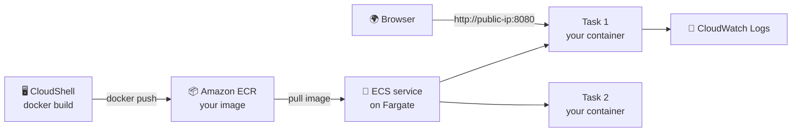

# Deploy Your First Container on AWS

### Hands-on with Amazon ECR & ECS Fargate

You'll take a small web app, **package it as a container**, **store it in Amazon ECR**, and **run it on Amazon ECS with AWS Fargate**, with no servers to manage. Then you'll ship a new version, watch ECS heal itself, and scale out.

- 🐳 **Docker** packages the app and everything it needs into one image
- 📦 **Amazon ECR** is your private image registry on AWS
- 🚀 **Amazon ECS + AWS Fargate** runs the container, so you never create or patch a server
- 📜 **Amazon CloudWatch Logs** shows what your container prints
- 🖥️ **AWS CloudShell** is a terminal in your browser with Docker already installed, so nothing is installed on your laptop

Every AWS step uses the **AWS Console**. No access keys, nothing to install.

> Built by **[CloudAdhar](https://youtube.com/@cloudadhar)**, Building Cloud Futures

---

## What you'll build



### The words you'll learn
| Word | Meaning in one line |
|---|---|
| **Image** | A packaged app: code + runtime + settings. Built once, runs anywhere |
| **Container** | A running copy of an image |
| **ECR repository** | A private folder on AWS where your images are stored |
| **Cluster** | A logical group for your containers in ECS |
| **Task definition** | The recipe: which image, how much CPU/memory, which port |
| **Task** | One running copy of the recipe (one or more containers) |
| **Service** | Keeps N tasks running all the time, and replaces any that stop |
| **Fargate** | AWS runs the servers for you. You only say "0.25 vCPU, 0.5 GB" |

---

## Cost of this workshop

| Item | Cost |
|---|---|
| CloudShell, ECS cluster, task definitions | Free |
| ECR storage for 2 small images (~60 MB) | Free (500 MB/month free) |
| Fargate: 0.25 vCPU + 0.5 GB, 1–2 tasks for ~2 hours | About US$0.05 |
| Public IPv4 address per running task | About US$0.005 per hour |
| CloudWatch Logs | Practically free |

**Total: less than US$0.10.** Do **Part 10: Clean up** at the end anyway!

---

## Repository structure

```
cloudadhar-first-container/
├── README.md         <- full workshop guide (you are here)
├── app.py            <- tiny Python web server (/ and /health)
├── index.html        <- the page you'll see (you'll edit it in Part 8)
├── Dockerfile        <- the recipe to build the image
├── .dockerignore     <- files kept out of the image
├── tests/            <- optional offline tests
└── docs/
    ├── PREREQUISITES.md
    └── INSTRUCTOR_NOTES.md
```

---

## Part 1: Before the workshop (10 min, at home)

Full checklist: **[docs/PREREQUISITES.md](docs/PREREQUISITES.md)**

1. **Sign in** as an IAM user (or IAM Identity Center user) with **AdministratorAccess**. Not the root user.
2. **Region:** top-right of the Console, choose **Asia Pacific (Mumbai) ap-south-1**. Use the **same region for every step**.
3. **Open CloudShell** (the `>_` icon in the top bar) and run `docker --version`. ✅ You see a version number.

---

## Part 2: Build and test the container in CloudShell (15 min)

### 2.1 Open CloudShell
1. Region = **ap-south-1** (top right).
2. Click the **CloudShell icon `>_`** in the top bar (next to the search box).
3. Wait about 30 seconds for the terminal.

### 2.2 Get the code
```bash
git clone https://github.com/cloudadhar/cloudadhar-first-container.git
cd cloudadhar-first-container
```

### 2.3 Read the Dockerfile
```bash
cat Dockerfile
```
Each line is one step: start from a small Python image → create a non-root user → copy `app.py` and `index.html` → set the port → say how to start the app. That's all a container image is.

### 2.4 Build the image
```bash
docker build -t cloudadhar-first-container:v1 .
docker images cloudadhar-first-container
```
✅ You see `cloudadhar-first-container   v1` with a size of about 60 MB.

### 2.5 Run it and test it
```bash
docker run -d --name web -p 8080:8080 -e PLATFORM="AWS CloudShell" cloudadhar-first-container:v1
curl http://localhost:8080/health
curl -s http://localhost:8080 | grep -E "version|Running on"
```
✅ `{"status": "healthy"}` and `Application version: v1`, `Running on: AWS CloudShell`.

Stop and remove it:
```bash
docker stop web && docker rm web
```

> ℹ️ CloudShell can't open `localhost` in your browser, so we use `curl`. In Part 5 you'll open the real thing in the browser.

---

## Part 3: Store the image in Amazon ECR (15 min)

### 3.1 Create the repository (Console)
1. **Elastic Container Registry (ECR)** → **Private registry** → **Repositories** → **Create repository**
2. **Repository name:** `cloudadhar-first-container`
3. Keep the other settings as they are → **Create**

### 3.2 Push the image (CloudShell)
Open your new repository and click **View push commands**. These are the same commands, ready to copy:

```bash
ACCOUNT_ID=$(aws sts get-caller-identity --query Account --output text)
REGISTRY=$ACCOUNT_ID.dkr.ecr.$AWS_REGION.amazonaws.com
REPO=$REGISTRY/cloudadhar-first-container

# 1. Log Docker in to your private ECR registry
aws ecr get-login-password | docker login --username AWS --password-stdin $REGISTRY

# 2. Give the image its ECR name, then push it
docker tag cloudadhar-first-container:v1 $REPO:v1
docker push $REPO:v1

echo "Your image URI: $REPO:v1"
```
✅ `Login Succeeded`, then the push finishes with a `digest: sha256:...` line.

> ℹ️ `$AWS_REGION` is set by CloudShell to the region you're in. No access keys are used: CloudShell uses your Console sign-in.

### 3.3 Check it (Console)
Refresh the repository page. ✅ You see an image with tag **v1**. Click it and **copy the Image URI** (it ends in `:v1`). You'll paste it in Part 4.

---

## Part 4: Create the cluster and task definition (15 min)

### 4.1 Create an ECS cluster
1. **Elastic Container Service (ECS)** → **Clusters** → **Create cluster**
2. **Cluster name:** `cloudadhar-cluster`
3. **Infrastructure:** keep **AWS Fargate (serverless)** only
4. **Create** (takes about 1 minute)

### 4.2 Create the task definition (the recipe)
1. **ECS** → **Task definitions** → **Create new task definition** → **Create new task definition**
2. **Task definition family:** `cloudadhar-first-container`
3. **Launch type:** **AWS Fargate** · **Operating system/Architecture:** **Linux/X86_64**
4. **Task size:** **CPU** `.25 vCPU` · **Memory** `.5 GB`
5. **Task role:** leave empty (our app doesn't call AWS)
6. **Task execution role:** **Create new role** (ECS uses this role to pull your image and send logs)
7. **Container – 1:**
   - **Name:** `web` · **Image URI:** *(paste from 3.3, ending in `:v1`)* · **Essential container:** Yes
   - **Port mappings:** **Container port** `8080` · **Protocol** TCP · **App protocol** HTTP
   - **Environment variables** → **Add environment variable**: **Key** `PLATFORM` · **Value** `Amazon ECS on AWS Fargate`
   - **Log collection:** keep **Use log collection** ticked (Amazon CloudWatch)
8. **Create**

> 👀 Notice we **don't** set `APP_VERSION` here. The version comes from the image, so in Part 8 the new image shows its own version.

---

## Part 5: Run it as an ECS service and open it in your browser (15 min)

### 5.1 Create the service
1. **ECS** → **Clusters** → `cloudadhar-cluster` → **Services** tab → **Create**
2. **Task definition family:** `cloudadhar-first-container` · **Revision:** latest
3. **Service name:** `cloudadhar-web`
4. **Compute options:** **Launch type** → **FARGATE**
5. **Desired tasks:** `1`
6. **Networking:**
   - **VPC:** default · **Subnets:** keep all selected
   - **Security group:** **Create a new security group**
     - **Name:** `cloudadhar-web-sg` · **Description:** `Workshop web access`
     - **Inbound rule:** **Type** Custom TCP · **Port range** `8080` · **Source** Anywhere
   - **Public IP:** **Turned on** ⚠️ *(without it, the task can't pull the image or be opened from your browser)*
7. **Create** and wait 1–2 minutes

> No default VPC? **VPC** → **Your VPCs** → **Actions** → **Create default VPC**.

### 5.2 Open your app 🎉
1. **Services** → `cloudadhar-web` → **Tasks** tab → wait until **Last status** is **Running**
2. Click the **task ID** → **Configuration** → copy the **Public IP**
3. In a new browser tab, open `http://<public-ip>:8080` (**http**, not https)

✅ Your page shows **Application version: v1**, **Running on: Amazon ECS on AWS Fargate**, and your region.

**Your container is now running on AWS, on a server you never had to create.**

---

## Part 6: See the logs (5 min)

1. In the task page → **Logs** tab
2. Refresh your app in the browser a few times, then refresh the logs
3. ✅ You see one JSON line per request: `{"client": "...", "request": "GET / HTTP/1.1", ...}`

Everything your container prints goes to **CloudWatch Logs** automatically. That's how you debug containers in production.

---

## Part 7: Self-healing and scaling (15 min)

### 7.1 Break it on purpose
1. **Tasks** tab → select the running task → **Stop** → **Stop selected**
2. Watch the **Tasks** tab (refresh). Within about a minute, ECS starts a **new task** by itself.
3. Open the new task's **Public IP** on port 8080. ✅ It works again, with a **new hostname**.

> 💡 The **service** promised "always 1 task running". When one stopped, ECS replaced it. Nobody had to wake up at 3 AM.
>
> Notice the **public IP changed**. That's why real apps put an **Application Load Balancer** in front: one fixed address, whatever happens to the tasks (see Bonus 1).

### 7.2 Scale out
1. **Services** → `cloudadhar-web` → **Update service**
2. **Desired tasks:** `2` → **Update**
3. ✅ Two tasks run. Open each Public IP: same app, **different hostnames**.

Set **Desired tasks** back to `1` when you're done, to save cost.

---

## Part 8: Ship version 2 (15 min)

### 8.1 Change the app (CloudShell)
```bash
cd ~/cloudadhar-first-container
nano index.html
```
Find the line under `<!-- Part 8 ... -->` and change the text to your own message, e.g. `Deployed by Priya on ECS Fargate 🚀`. Save with `Ctrl+O`, `Enter`, exit with `Ctrl+X`.

### 8.2 Build and push v2
```bash
ACCOUNT_ID=$(aws sts get-caller-identity --query Account --output text)
REPO=$ACCOUNT_ID.dkr.ecr.$AWS_REGION.amazonaws.com/cloudadhar-first-container

docker build --build-arg APP_VERSION=v2 -t $REPO:v2 .
aws ecr get-login-password | docker login --username AWS --password-stdin ${REPO%%/*}
docker push $REPO:v2
```
✅ ECR now shows two tags: **v1** and **v2**.

### 8.3 Deploy v2 (Console)
1. **ECS** → **Task definitions** → `cloudadhar-first-container` → select the latest revision → **Create new revision**
2. In **Container – 1**, change the **Image URI** ending from `:v1` to `:v2` → **Create** (this is revision 2)
3. **Clusters** → `cloudadhar-cluster` → **Services** → `cloudadhar-web` → **Update service**
4. **Revision:** choose the new one (2) → **Update**
5. Open the **Deployments** tab: ECS starts a v2 task, checks it is running, then stops the v1 task. This is a **rolling deployment**.
6. Open the new task's Public IP. ✅ **Application version: v2** with your message!

> Something wrong with v2? Update the service back to revision 1. That's a **rollback**, in one click.

---

## Part 9: What just happened? (recap)

```
Code (GitHub) ──docker build──▶ Image ──docker push──▶ ECR ──pull──▶ ECS Fargate task
                                                                       ▲
                                     Service keeps N tasks running ────┘
```
- **ECR** stores versions of your image (`v1`, `v2`).
- The **task definition** says *which* image and *how much* CPU/memory.
- The **service** keeps the right number of tasks running, replaces failed ones, and rolls out new versions.
- **Fargate** means you never created, patched or paid for an idle EC2 server.

---

## Part 10: Clean up (10 min). Don't skip this!

Do these **in order**:

| # | Delete | Where |
|---|---|---|
| 1 | Service `cloudadhar-web` | ECS → Clusters → `cloudadhar-cluster` → Services → select → **Delete service** → tick **Force delete** → type `delete` |
| 2 | Cluster `cloudadhar-cluster` | ECS → Clusters → `cloudadhar-cluster` → **Delete cluster** (after the tasks have stopped) |
| 3 | Task definition `cloudadhar-first-container` | ECS → Task definitions → select it → select all revisions → **Actions** → **Deregister**, then **Actions** → **Delete** |
| 4 | ECR repository `cloudadhar-first-container` | ECR → Repositories → select → **Delete** → type `delete` (deletes the images too) |
| 5 | Security group `cloudadhar-web-sg` | EC2 → Security Groups → select → **Actions** → **Delete security groups** |
| 6 | Log group `/ecs/cloudadhar-first-container` | CloudWatch → Log groups → select → **Actions** → **Delete** |
| 7 | *(optional)* IAM role `ecsTaskExecutionRole` | IAM → Roles → search → **Delete** (it's free, so keeping it is fine) |

✅ Check: **ECS → Clusters** is empty and **ECR → Repositories** is empty. No running tasks means no cost.

---

## Bonus challenges

1. **Application Load Balancer:** create the service with **Load balancing** → **Application Load Balancer**, so the app has one fixed URL. *(An ALB costs about US$0.02/hour, so delete it afterwards.)*
2. **Auto scaling:** in the service, add **Service auto scaling** with a target of 50% CPU, min 1, max 3 tasks.
3. **Health check:** in the task definition, add a container health check: `CMD-SHELL, python -c "import urllib.request; urllib.request.urlopen('http://127.0.0.1:8080/health')" || exit 1`.
4. **CI/CD:** automatically build, push and deploy on every `git push` with GitHub Actions and OIDC (no access keys).
5. **Try a different image:** create a new task definition with the public image `public.ecr.aws/nginx/nginx:latest` on port 80.

---

## Troubleshooting

| Problem | Fix |
|---|---|
| `docker: command not found` in CloudShell | Close the tab and reopen CloudShell; Docker is preinstalled in most regions. Try **ap-south-1** or **us-east-1** |
| `no basic auth credentials` on `docker push` | Run the `aws ecr get-login-password ... docker login` line again (the login expires after 12 hours) |
| `repository ... does not exist` on push | The ECR repo name or region doesn't match. It must be `cloudadhar-first-container` in the **same region** as CloudShell |
| Task stops with `CannotPullContainerError` | **Public IP** was off, or the Image URI is wrong. Check the URI ends in `:v1`, and recreate the service with Public IP **Turned on** |
| Task stops with `ResourceInitializationError` | Same as above: usually no public IP, so the task can't reach ECR |
| Browser keeps loading / times out | Use `http://` (not https) and port `:8080`. Check the security group allows **TCP 8080** from **Anywhere** |
| Page shows `Application version: v1` after deploying v2 | The service still uses the old revision, or you pushed v2 to a different tag. Check the task's image URI ends in `:v2` |
| Task status is **Pending** for a long time | Wait 2 minutes. Still pending? Open the task → **Stopped reason** |
| Can't delete the cluster | The service still has tasks. Delete the service first (step 1) and wait until the tasks stop |
| Can't delete the security group | A task is still using it. Wait until all tasks have stopped |

---

## Run it on your own laptop (optional)

```bash
docker build -t cloudadhar-first-container:v1 .
docker run --rm -p 8080:8080 cloudadhar-first-container:v1
```
Then open http://localhost:8080.

Tests (no Docker or AWS needed): `pip install pytest && pytest -q`

---

## Security notes
- The container runs as a **non-root user** (`USER cloudadhar` in the Dockerfile).
- The image comes from **Amazon ECR Public** (`public.ecr.aws`), which avoids Docker Hub rate limits.
- **No access keys** anywhere: CloudShell uses your Console sign-in, and ECS uses the task execution role.
- Port 8080 is open to the internet only for this workshop. In production, put an ALB in front and keep tasks in private subnets.

---

## License
MIT. Free for learning and teaching. Please credit **CloudAdhar** when sharing.

**Follow CloudAdhar:** [YouTube](https://youtube.com/@cloudadhar) · [Instagram](https://instagram.com/cloudadhar) · [LinkedIn](https://linkedin.com/in/gangadharure)
